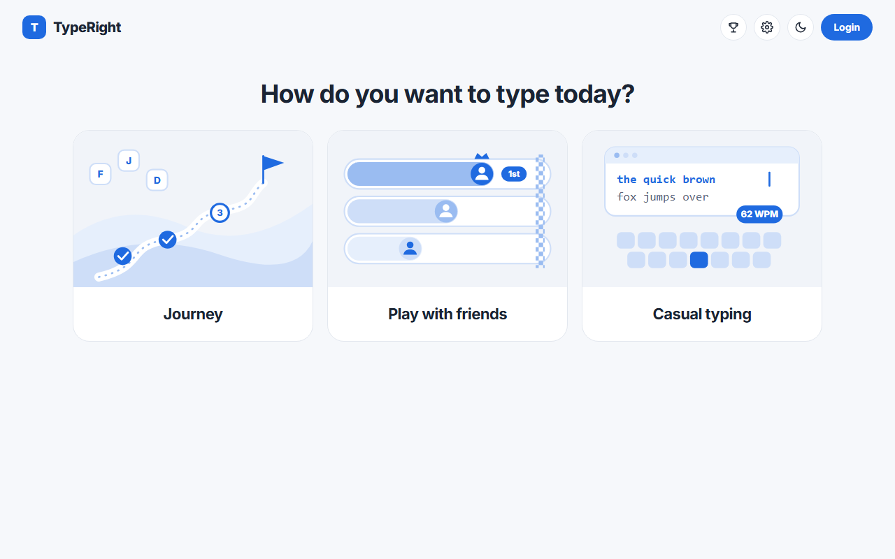
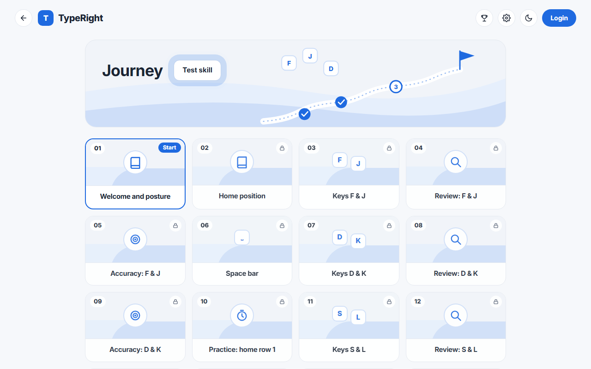
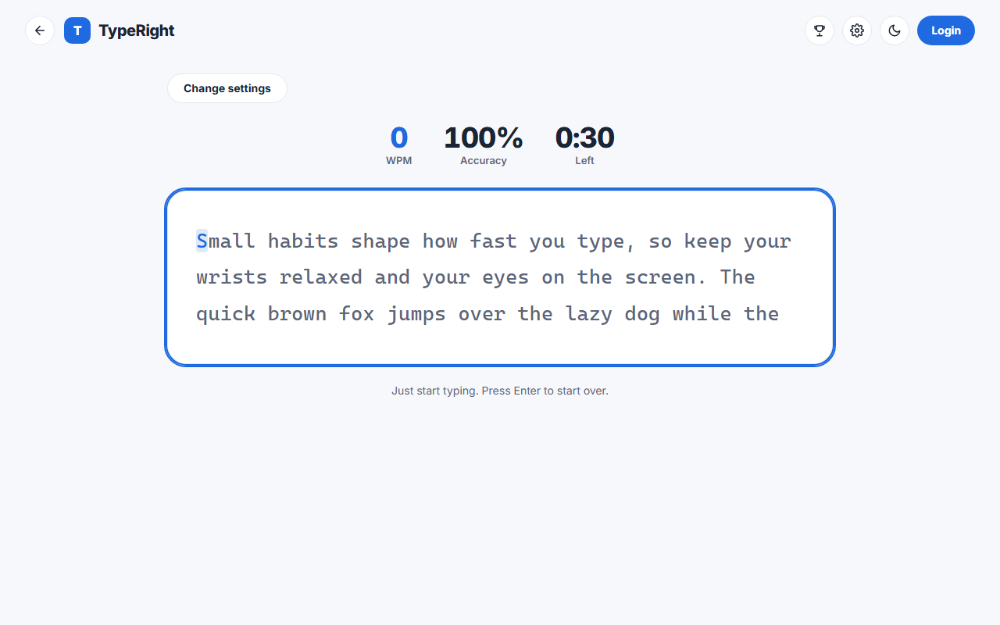
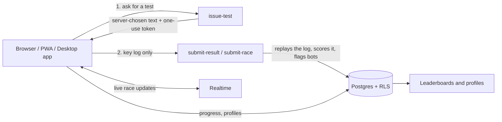

# TypeRight

A free typing trainer that teaches correct finger placement, then lets you race friends.
Learn on a 200-lesson Journey, practice casually in English or Filipino, and compete on server-checked leaderboards.

**Live site:** https://typeright.vercel.app (free, no account needed)


## Screenshots

| Pick a mode | Journey |
|---|---|
|  |  |



## Features

- **Journey:** 200 lessons in 13 stages, from posture and the home row to numbers, symbols, words and sentences. A lesson unlocks when you pass the one before it (90% to pass, with stars). An optional **Test skill** level test skips the stages you already know.
- **Finger-guided keyboard:** an on-screen keyboard shows which finger to use for each key.
- **Casual typing:** English or Filipino, 10 s, 30 s, 1 min, 2 min or endless, with live WPM and accuracy. Casual runs have a leaderboard per length.
- **Weak-key practice:** drills built from the keys you miss most.
- **Play with friends:** private or public rooms for 2 to 8 players, with a live race over Supabase Realtime.
- **Accounts or guests:** email or Google login. Guests can play without signing up, and their progress lives in the tab.
- **Badges, streaks and public profiles.**
- **Installable:** works as a PWA, and as a Windows desktop app (Tauri) that keeps working offline.
- **Light and dark mode**, phone-friendly layout, keyboard-accessible.

## Tech stack

| Part | Choice |
|---|---|
| Frontend | React 19, Vite, TypeScript, Tailwind CSS v4, React Router, Zustand |
| Backend | Supabase: Postgres with row-level security, Auth, Realtime, Edge Functions |
| Hosting | Vercel (auto-deploys from `main`) |
| Desktop | Tauri 2 (Windows) |
| Tests | Vitest (103 tests) |
| Cost | ₱0 (all free tiers) |

## How it works



The browser never reports its own speed. It sends the raw key log, and the server replays it to work out WPM and accuracy. The scoring code is shared between the app and the Edge Functions (`supabase/functions/_shared/scoring.ts`), so both sides use the same math.

## Problem I solved

An online leaderboard is only fun if the numbers are real. If the browser just sent "I typed 200 WPM", anyone could edit that request. So TypeRight:

- picks the text on the server and hands out a one-use token,
- takes only the key log from the browser and replays it on the server,
- checks the log fits the real time that passed, and rate-limits each user,
- flags runs that look scripted (over 180 WPM, or gaps between keys that are too even) and keeps them off the boards,
- times finished race runs from the race start, so waiting before the first key doesn't shorten your window.

Honest limit: a script that copies a real person's typing rhythm closely can still get through. Details are in [docs/SECURITY.md](docs/SECURITY.md).

## Run it locally

You need Node.js 20.19 or newer (or 22.12+) and a free [Supabase](https://supabase.com) project.

```bash
git clone https://github.com/dewdew-del/typeright.git
cd typeright
npm install
```

Copy `.env.example` to `.env` and fill in the public values from Supabase (Project Settings → API Keys):

```
VITE_SUPABASE_URL=
VITE_SUPABASE_PUBLISHABLE_KEY=
```

Then start the dev server:

```bash
npm run dev
```

Other commands:

```bash
npm test               # run the unit tests
npm run build          # type check + production build
npm run desktop:dev    # desktop app window (needs Rust, see docs/DESKTOP.md)
npm run desktop:build  # Windows installer
```

Database tables and security rules are in `supabase/migrations/`. Dashboard-only switches (Google login, anonymous sign-ins, Turnstile) are listed in [docs/SUPABASE_SETUP.md](docs/SUPABASE_SETUP.md).

## Project layout

```
src/
  pages/        screens (Journey, Casual, Friends, RaceRoom, Leaderboard ...)
  engine/       typing engine, scoring helpers, progress (pure TypeScript)
  content/      lessons, word lists, stories and race texts (English + Filipino)
  storage/      progress and auth stores, Supabase sync
  components/   keyboard, typing area, charts, wallpapers
supabase/
  migrations/   database schema and row-level security
  functions/    issue-test, submit-result, submit-race, delete-account
src-tauri/      Windows desktop wrapper
docs/           plan, status, security, setup and lesson design notes
```

## More docs

- [docs/STATUS.md](docs/STATUS.md): where things stand
- [docs/PLAN.md](docs/PLAN.md): the full plan and data model
- [docs/JOURNEY.md](docs/JOURNEY.md) and [docs/LESSONS.md](docs/LESSONS.md): how the lessons are designed
- [docs/SECURITY.md](docs/SECURITY.md): protections, review findings, open items
- [docs/DESKTOP.md](docs/DESKTOP.md): building the desktop app

## Credits

Built by Dewdew as a portfolio project.
